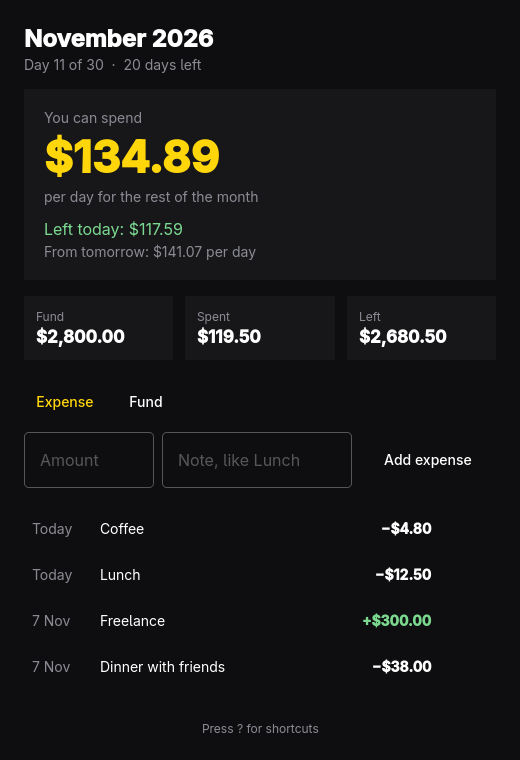

# Oma Spend



Oma Spend shows the current month, the money you've set aside for it, and how much
you can spend each day for the rest of the month.

- **Fund**: what you put in for the month. Add more than one, such as salary
  and a top-up, and they add up.
- **Per day**: what was left at the start of today, split evenly over today
  and the remaining days. Today's spending doesn't change it.
- **Left today**: today's allowance minus what you've spent today.
- **From tomorrow**: once you've spent something today, what each remaining
  day gets.

Each month starts empty. Records stay in `~/.local/share/oma_spend/oma_spend.json`.

Amounts are dollars with up to two decimals, like `12.50` or `$1,250`, up to
$90,071,992,547,409.91 for one entry or for a month's total. If the records file
can't be read, or doesn't look like Oma Spend data, the window shows why and
won't save over it.

## Install

```sh
bin/install
```

This builds the app, runs the tests, and installs it for your user, with no
sudo needed. The program goes in `~/.local/bin`, and the launcher entry and icon
in `~/.local/share`, so Oma Spend shows up in the Omarchy app launcher
(`Super + Space`). Run it again after any change.

`bin/uninstall` removes the app and leaves your records in place.

## Shortcuts

| Key | Action |
|---|---|
| E or Space | Add an expense |
| F | Add to this month's fund |
| Enter | Save the entry |
| Esc | Clear the entry |
| Ctrl+Z | Undo |
| Ctrl+Shift+Z | Redo |
| ? | Show or hide shortcuts |
| Q | Quit |

Hover an entry and click ✕ to remove it. Ctrl+Z brings it back.

## Command line

```sh
oma_spend                       # open the window
oma_spend status [--json]       # this month's fund, spending and daily allowance
oma_spend spend 12.50 Lunch     # record an expense for today
oma_spend fund 3000 Salary      # add to this month's fund
```

Each command exits 0, or 1 with the reason on stderr. An open window picks up
changes made from the command line. The window and any number of commands can
record at the same time without losing each other's entries; a failed save
records nothing, so it's safe to try again.

## Develop

```sh
bin/build    # build/oma_spend
bin/test     # Qt Test, offscreen
```

Set `OMA_SPEND_DATA_FILE` to use a different data file.
